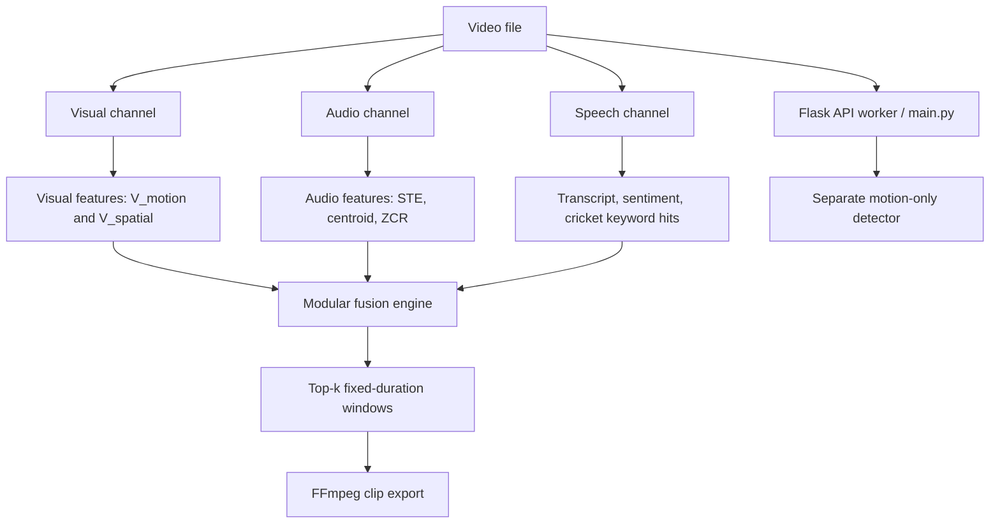

# Multimodal Sports Highlight Extraction

This project experiments with detecting highlight windows by combining visual motion, audio energy, and commentary features.
It evaluates generic cricket and football video inputs, while making clear that the current code does not contain football-specific event detection or human-verified accuracy results.

## Demo / sample output

The official football highlight reel sanity check selected these three six-second windows:

```json
{
  "video": "football_official_highlights.mp4",
  "fusion_windows": [[183, 189], [385, 391], [546, 552]],
  "flagged_percent": 2.514,
  "interpretation": "sanity check on an official highlight reel only; not an accuracy metric"
}
```

The input video is not included in the repository. The machine-readable report is [`results/sanity_football_highlights.json`](results/sanity_football_highlights.json). The same procedure flagged 2.034% of the cricket highlight reel; neither number measures accuracy.

## Key features

- Separate visual, audio, and speech feature pipelines that write timestamped JSON.
- Fusion engine with configurable channel weights and top-k, non-overlapping windows.
- Evaluation against interval labels with IoU matching and single-channel ablations.
- A pseudo-label generator that locates highlight-reel frames in full-match visual embeddings.
- A held-out-match fusion weight experiment for the two cricket matches available in this evaluation.
- Generic visual/audio/speech processing was also run on one football match. No football-specific event classifier, terminology, or human-labeled dataset exists in this repository.

## Architecture



- **Visual:** samples frames, extracts MobileNetV3-Small embeddings, and calculates Farneback optical flow. The fusion engine consumes the `V_motion` score; embeddings are used by the pseudo-label matcher, not normal fusion.
- **Audio:** FFmpeg and librosa produce per-second short-time energy (STE), spectral centroid, and zero-crossing rate. Fusion consumes STE.
- **Speech:** faster-whisper `small` transcribes English commentary. NLTK VADER and a hard-coded cricket keyword list produce sentiment and keyword features; the fusion score uses sentiment and keyword hit. Memory-bounded feature extraction is used for long files.
- **Fusion:** `fusion_channel/fusion_engine.py` min-max normalizes visual motion, STE, and `sentiment_score + 0.5 * keyword_hit`, applies weights `(0.4, 0.4, 0.2)`, and ranks up to three non-overlapping six-second windows by default. This is a fixed-window ranking, not a learned event classifier.
- **Application integration:** the Flask worker calls `main.py`, a separate OpenCV frame-difference detector; it does not call the three channels or modular fusion. `fusion_pipeline.py` is another offline path with different scoring behavior.
- **Football:** the generic channels accept football video, but their speech vocabulary and labels are cricket-oriented and no football-specific logic is implemented. Running them on football is not equivalent to football event detection.

## Human-labeled evaluation

Two cricket matches were independently labeled by a single human labeler (20 highlight intervals per match, labeled before seeing any model output). Matching uses IoU >= 0.5 with strict one-to-one maximum matching. A clearly labeled looser metric allows a predicted window to overlap a truth interval expanded by ±10 seconds, also one-to-one.

### Original pipeline

The original pipeline (fixed six-second windows, global min-max fusion) produced near-zero strict F1 on both matches with human labels. At k = 3 all variants scored strict F1 = 0.0000 on both matches; at k = 10 all variants (audio_only, speech_only, visual_only, full_fusion) also scored F1 = 0.0000 on both matches (see [`results/eval_at_k.md`](results/eval_at_k.md), human_verified section).

### Channel diagnostic: ROC-AUC with 95% bootstrap CIs

Per-second channel scores ranked against human labels. Bootstrap: 1000 resamples, fixed seed, labeled intervals sampled with replacement.

| Channel | Match 1 AUC [95% CI] | Match 2 AUC [95% CI] | Pooled AUC [95% CI] |
|---|---|---|---|
| Visual | 0.4785 [0.4398, 0.5159] | 0.5828 [0.5390, 0.6297] | 0.5292 [0.5003, 0.5568] |
| Audio | 0.6576 [0.6178, 0.6947] | 0.6524 [0.6059, 0.6948] | 0.6554 [0.6267, 0.6828] |
| Speech | 0.4938 [0.4508, 0.5318] | 0.6103 [0.5677, 0.6561] | 0.5544 [0.5211, 0.5852] |

### Peak-based selection

Local rolling z-score normalization (120 s window), 5 s smoothing, 30 s peak separation, variable 8–30 s windows. These defaults were fixed before the match-2 run. Peak selection was developed and diagnosed on match 1; match 2 was an untouched confirmation set.

**Match 2 (confirmation) — audio peak selection with baselines:**

| Variant | k | Strict P | Strict R | Strict F1 | Looser P | Looser R | Looser F1 | Random strict F1 | Even strict F1 |
|---|---:|---:|---:|---:|---:|---:|---:|---:|---:|
| audio | 5 | 0.0000 | 0.0000 | 0.0000 | 0.8000 | 0.2000 | 0.3200 | 0.0040 +/- 0.0174 | 0.0000 |
| audio | 10 | 0.1000 | 0.0500 | 0.0667 | 0.7000 | 0.3500 | 0.4667 | 0.0087 +/- 0.0224 | 0.0000 |
| audio | 20 | 0.1000 | 0.1000 | 0.1000 | 0.5000 | 0.5000 | 0.5000 | 0.0115 +/- 0.0222 | 0.0000 |
| audio | 40 | 0.0750 | 0.1500 | 0.1000 | 0.2750 | 0.5500 | 0.3667 | 0.0167 +/- 0.0224 | 0.0333 |

The complete match-2 table (all variants at all k) is in [`results/confirm_match2.md`](results/confirm_match2.md).

### Interpretation

Only the audio channel (short-time energy) carries a replicated ranking signal (ROC-AUC 0.6576 on match 1 and 0.6524 on match 2). Visual and speech were inconsistent and are not claimed as signals. Audio peak selection was above the random baseline on match 2 at k=10, 20 and 40 on strict IoU matching, but absolute performance is low (at k=10 it is a single matched interval: F1 0.0667 vs random mean 0.0087). The audio signal was discovered on match 1 labels, so match 1 results are optimistic; match 2 is the untouched confirmation set. This is evidence of a weak but replicated audio signal, not a reliable highlight detector.

### Notes on these results

- F1 bootstrap CIs are not reported because resampling intervals can only lower matches, so the interval's upper bound equals the point estimate; AUC CIs are reported instead.
- The looser ±10 s metric has no random baseline computed yet; do not quote it as evidence of beating chance.
- Results files were generated at commit `822c708f...`, before the final code commit `e054022` and results commit `65bbec7`.
- Single labeler, 20 intervals per match, two matches, no football human labels, no tuning on match 2.

## Results (pseudo-label)

Metrics below compare predictions with generated visual-similarity pseudo-labels, not independent human annotations. Matching uses IoU >= 0.5 and maximum one-to-one interval matching. Each evaluation ranks at most three six-second windows, while pseudo ground truth contains 61–68 intervals.

| Match | Variant | Precision | Recall | F1 |
|---|---|---:|---:|---:|
| Cricket 1 | Audio only | 0.0000 | 0.0000 | 0.0000 |
| Cricket 1 | Speech only | 0.0000 | 0.0000 | 0.0000 |
| Cricket 1 | Visual only | 0.0000 | 0.0000 | 0.0000 |
| Cricket 1 | Full fusion | 0.0000 | 0.0000 | 0.0000 |
| Cricket 2 | Audio only | 0.0000 | 0.0000 | 0.0000 |
| Cricket 2 | Speech only | 0.6667 | 0.0299 | 0.0571 |
| Cricket 2 | Visual only | 0.0000 | 0.0000 | 0.0000 |
| Cricket 2 | Full fusion | 0.3333 | 0.0149 | 0.0286 |
| Football 1 | Audio only | 0.3333 | 0.0164 | 0.0313 |
| Football 1 | Speech only | 0.3333 | 0.0164 | 0.0313 |
| Football 1 | Visual only | 0.0000 | 0.0000 | 0.0000 |
| Football 1 | Full fusion | 0.3333 | 0.0164 | 0.0313 |

Cricket weight experiment, training on the entirety of Cricket 1 and testing on the separate Cricket 2:

| Method | Weights (visual, audio, speech) | Test precision | Test recall | Test F1 |
|---|---|---:|---:|---:|
| Hand-set | (0.4, 0.4, 0.2) | 0.3333 | 0.0149 | 0.0286 |
| Simplex grid search | (0.0, 0.4, 0.6) | 0.6667 | 0.0299 | 0.0571 |
| Logistic regression | Learned coefficients | 0.0000 | 0.0000 | 0.0000 |

These are one held-out split across two cricket matches, with pseudo-labels; they do not establish generalization. Only one football match was available, so football weights were not trained or tested cross-match. See [evaluation methodology and runtime details](docs/results.md) and JSON under [`results/`](results/).

## Tech stack

Python, OpenCV, PyTorch/TorchVision (MobileNetV3-Small), NumPy, pandas, librosa, FFmpeg, faster-whisper, NLTK/VADER, Flask, SQLAlchemy, React, Vite, and Tailwind CSS.

Pretrained model files are not included. TorchVision and faster-whisper may download weights when first run. `data/`, video files, model weights, environment files, and virtual environments are ignored by Git.

## Installation and quick start

The evaluation ran in an environment where dependencies and model caches already existed; a clean installation was not verified. These are the project setup commands:

```powershell
python -m venv .venv
.\.venv\Scripts\Activate.ps1
python -m pip install -r requirements.txt
```

FFmpeg must be installed and available on `PATH`. To run channels and record per-channel time/RSS for a local video:

```powershell
python benchmark_channels.py --video data\videos\match.mp4 --output-dir data\processed\match --model-size small
```

The benchmark reuses valid existing channel outputs; use `--force` to recompute. To generate selected clips from the cricket channel outputs:

```powershell
python -c "from fusion_channel.fusion_engine import run_fusion_pipeline; run_fusion_pipeline(source_video=r'data\videos\cricket_full_match.mp4', vis_file=r'data\processed\cricket_full_match\visual_output.json', aud_file=r'data\processed\cricket_full_match\audio_output.json', speech_file=r'data\processed\cricket_full_match\speech_output.json', out_json=r'results\cricket_match_1_selected.json', top_k=3, window_sec=6.0)"
```

This prints the selected time ranges, writes them to `results\cricket_match_1_selected.json`, and renders MP4 clips under `output_highlights\` (`highlight_01.mp4`, etc.). It uses the default hand-set fusion weights `(0.4, 0.4, 0.2)`. If those output names already exist, new files get an incrementing suffix (for example, `highlight_01_2.mp4` and `cricket_match_1_selected_2.json`); existing files are preserved. FFmpeg refuses to overwrite an existing clip. Stream-copy trimming can make clip boundaries approximate, so inspect clips before presenting them. These are ranked model selections, not verified highlights.

For football, use `data\videos\football_full_match.mp4`, the corresponding three JSON files under `data\processed\football_full_match\`, and an output JSON path such as `results\football_match_1_selected.json`. This runs the generic pipeline, not football-specific event detection.

To evaluate ablations against interval labels (`[[start, end], ...]`):

```powershell
python evaluate.py --sport cricket `
  --visual data\processed\match\visual_output.json `
  --audio data\processed\match\audio_output.json `
  --speech data\processed\match\speech_output.json `
  --ground-truth results\ground_truth.json `
  --output results\match_evaluation.json
```

Run the synthetic smoke test with `python test_pipeline.py`. It checks pipeline execution/export, not recognition quality.

## Usage examples for both sports

The same generic channels can process a football file, and the evaluation CLI accepts `football` as a report label. This does not add sport-specific event detection:

```powershell
python benchmark_channels.py --video data\videos\football_match.mp4 --output-dir data\processed\football_match --model-size small
python evaluate.py --sport football `
  --visual data\processed\football_match\visual_output.json `
  --audio data\processed\football_match\audio_output.json `
  --speech data\processed\football_match\speech_output.json `
  --ground-truth results\football_ground_truth.json `
  --output results\football_evaluation.json
```

Change the sport label and input paths for cricket. For a pseudo-label from an official reel, first process the full match and reel with `benchmark_channels.py`, then run:

```powershell
python auto_generated_ground_truth.py `
  --full-visual-json data\processed\match\visual_output.json `
  --highlight-visual-json data\processed\official_highlights\visual_output.json `
  --output results\match_ground_truth.json
```

The result is pseudo ground truth and needs manual review before it is treated as annotation.

## Project structure

```text
app/                 Flask API, database models, and job routes
audio_channel/       Audio extraction and acoustic features
docs/                Evaluation methodology, results, and limitations
frontend/            React/Vite dashboard
fusion_channel/      Modular fusion and highlight window export
results/             Machine-readable generated evaluation reports
speech_channel/      Whisper transcription and commentary features
tests/               Regression tests for bounded processing and utilities
visual_channel/      Frame sampling, visual embeddings, and optical flow
main.py              Separate motion-only application worker
fusion_pipeline.py   Alternate offline fusion implementation
evaluate.py          IoU evaluation and modality ablations
training_weights.py  Match-held-out weight experiment
```

## Limitations and future work

- Match labels are pseudo ground truth from visual similarity to official highlight reels, not manually verified event annotations. Unmatched reel segments and merged intervals are not confirmed true/false events.
- Results cover two cricket matches and one football match. Only cricket has a distinct train/test match pair; even that is a single split and not generalization evidence.
- The top-three prediction cap is restrictive relative to the number of pseudo-label intervals.
- There is no football event model or football vocabulary. Speech processing is English-language and the keyword vocabulary is cricket-specific.
- The Flask worker remains motion-only; full multimodal channels and modular fusion are not wired into the application job path. The file picker does not upload browser-selected files.
- Clean dependency installation, frontend build, and API launch with a configured database were not validated.
- The evaluation hardware was Windows 11 with an RTX 2050 (4 GiB VRAM) and 7.73 GiB RAM. Runtime results depend on that hardware and the observed implementation differences.

Next steps: manually annotate a representative set of matches, validate across more held-out matches, create football event features, connect the multimodal pipeline to the application, and add outcome assertions for detection quality.

Additional limitations identified during human-label evaluation:
- Window-boundary placement: strict IoU >= 0.5 misses near-miss windows that overlap the correct event but whose boundaries are slightly off.
- A pretrained audio-event model (e.g., YAMNet or PANNs) could replace or augment raw short-time energy.
- A third labeled match would be needed for any hyperparameter tuning (currently only two matches, with match 2 reserved as an untouched confirmation set).
- The looser ±10 s metric lacks a random baseline, so it cannot be used to claim above-chance performance.
- No football human labels exist; all human-label findings are cricket-only.

## Evaluation at k

[`eval_at_k.py`](eval_at_k.py) reuses the existing fusion selection and IoU >= 0.5 maximum one-to-one matching, but evaluates 6-second windows at k = 3, 10, 20, 40, 60, and 80. It reads the existing channel JSONs without recomputing them. The complete, run-generated table (one row per match, variant, and k) is in [`results/eval_at_k.md`](results/eval_at_k.md); its JSON counterpart is [`results/eval_at_k.json`](results/eval_at_k.json). Random-baseline precision is the mean +/- population standard deviation over 100 deterministic random selections with the fusion selector's 3-second spacing rule.

| Match | Best full-fusion k | Full-fusion precision | Full-fusion recall | Full-fusion F1 | Random-baseline precision |
|---|---:|---:|---:|---:|---:|
| cricket_match_1 | 80 | 0.1250 | 0.1471 | 0.1351 | 0.0166 +/- 0.0140 |
| cricket_match_2 | 60 | 0.1167 | 0.1045 | 0.1102 | 0.0150 +/- 0.0159 |
| football_match_1 | 80 | 0.1375 | 0.1803 | 0.1560 | 0.0227 +/- 0.0161 |

Interpretation: increasing k removes the artificial top-three recall ceiling, and several variants exceed the random-baseline mean precision. This remains pseudo-label evaluation, not confirmation of true event-detection quality. If a manual file created with [`label_tool.py`](label_tool.py) is present, the evaluator adds a separate human-verified, single-labeler result with its actual interval count.

## Peak-based selection

[`fusion_channel/peak_fusion.py`](fusion_channel/peak_fusion.py) is a separate experiment; the original fusion engine and scoring code are unchanged. Defaults were chosen before consulting human-label metrics: 120-second centered rolling z-scores clipped to [-3, 3], 5-second smoothing, equal channel weights, and 30-second peak separation. Peak windows begin 12 seconds before a peak and have variable 8--30 second duration. The complete strict, looser, random, evenly-spaced, and old-method tables are in [`results/peak_evaluation.md`](results/peak_evaluation.md), with detailed data in [`results/peak_evaluation.json`](results/peak_evaluation.json).

### Human-verified: cricket_match_1, 20 intervals, single labeler

| Variant | k | New strict F1 | Old strict F1 | New loose F1 | Old loose F1 |
|---|---:|---:|---:|---:|---:|
| visual | 10 | 0.0000 | 0.0000 | 0.0667 | 0.1333 |
| audio | 10 | 0.2667 | 0.0000 | 0.3333 | 0.1333 |
| speech | 10 | 0.0000 | 0.0000 | 0.0000 | 0.0000 |
| equal_fusion | 10 | 0.0667 | 0.0000 | 0.1333 | 0.0667 |
| visual | 20 | 0.0000 | 0.0000 | 0.1000 | 0.1000 |
| audio | 20 | 0.2000 | 0.1000 | 0.3000 | 0.2000 |
| speech | 20 | 0.0500 | 0.0000 | 0.0500 | 0.0500 |
| equal_fusion | 20 | 0.0500 | 0.0000 | 0.1500 | 0.0500 |
| visual | 40 | 0.0000 | 0.0000 | 0.1333 | 0.1000 |
| audio | 40 | 0.1667 | 0.0667 | 0.3000 | 0.1333 |
| speech | 40 | 0.0333 | 0.0000 | 0.1333 | 0.0667 |
| equal_fusion | 40 | 0.0333 | 0.0000 | 0.1333 | 0.1333 |
| visual | 60 | 0.0000 | 0.0000 | 0.1500 | 0.1250 |
| audio | 60 | 0.1250 | 0.0500 | 0.2250 | 0.1250 |
| speech | 60 | 0.0250 | 0.0250 | 0.1500 | 0.0750 |
| equal_fusion | 60 | 0.1000 | 0.0000 | 0.1750 | 0.1000 |

### Pseudo-label results

The full pseudo-label table covers every match, variant, and k in [`results/peak_evaluation.md`](results/peak_evaluation.md). The channel-signal diagnostic is in [`results/channel_signal.md`](results/channel_signal.md). Human-label results are one match, 20 intervals, and one labeler; no peak-selector hyperparameter was tuned on those labels. The sensitivity grid reports all 60/120/240-second and 3/5/10-second combinations rather than selecting a human-label winner.

Interpretation: audio has human-label ROC-AUC 0.6576, while visual (0.4785), speech (0.4938), and the original fused score (0.4902) do not demonstrate comparable ranking signal on this set. The new audio peak selector exceeds its random strict-F1 mean at every reported k; equal fusion does so at k=10, 20, 40, and 60, but remains far below a reliable detector. These are small-sample findings, not a generalization claim.

## Team and acknowledgements

Team member names and roles were not present in the repository and are not invented here; add verified names before external presentation. The project depends on the open-source libraries listed above and TorchVision MobileNetV3-Small pretrained weights. Video sources and contributor acknowledgements should be credited according to their actual licenses and provenance.
