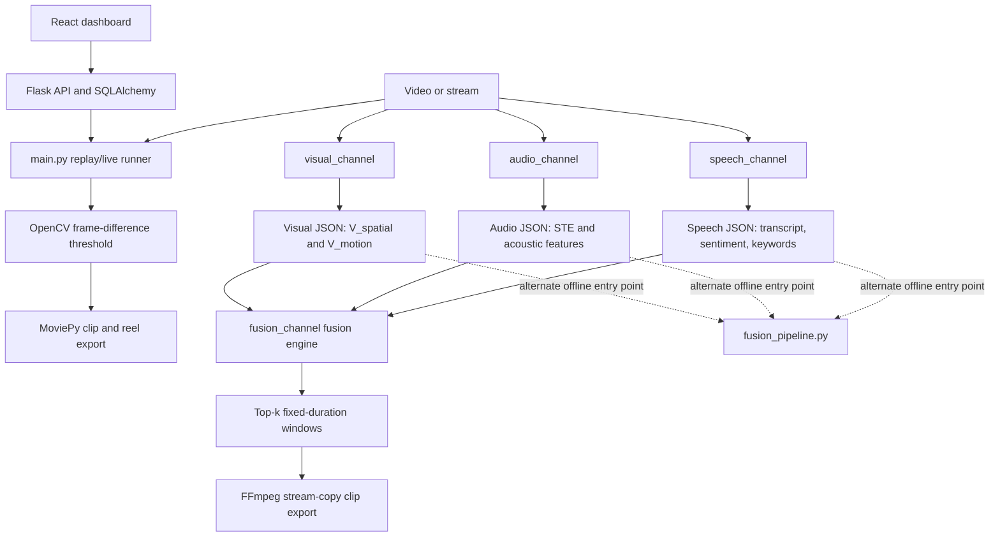

# Multimodal Sports Highlight Extraction

This B.Tech project explores automatic highlight detection by combining visual motion, audio energy, and commentary signals.
The checked-in code is primarily cricket-oriented; football-specific event detection and verified match-level accuracy results are not available.

## Demo / sample output

The repository includes a synthetic integration-test output, not a real-match result:

```json
{
  "source_video": "synthetic_test.mp4",
  "highlights": [[3.0, 7.0]]
}
```

This example is from [`fusion_channel/fused_highlights.json`](fusion_channel/fused_highlights.json). The synthetic input video is generated by `test_pipeline.py` and is not checked in.

## Key features

- Sparse visual sampling, MobileNetV3 embeddings, and optical-flow motion features.
- Audio energy, spectral centroid, and zero-crossing-rate features.
- English commentary transcription and sentiment/keyword features using a cricket keyword list.
- A separate fusion engine that ranks fixed-duration highlight windows from the channel feature JSON.
- A Flask job API and React dashboard for replay/live job submission and status display.
- No football-specific classifier, football event vocabulary, or football evaluation dataset is implemented in the checked-in code.

## Architecture



The repository currently contains separate paths rather than one connected multimodal application. The Flask replay/live worker invokes `main.py`, which detects frame-to-frame pixel changes and exports clips; it does not call the audio, speech, or fusion modules. The modular channel scripts produce timestamped JSON. `fusion_channel/fusion_engine.py` normalizes `V_motion`, `STE`, and `sentiment_score + 0.5 * keyword_hit`, applies weights `(0.4, 0.4, 0.2)`, then selects top-scoring non-overlapping windows. `fusion_pipeline.py` is another offline implementation with different scoring and segment rules; it is not called by the Flask worker.

### Channels

- **Visual:** extracts about one frame per second, obtains a 576-dimensional feature vector from pretrained MobileNetV3-Small, and calculates Farneback optical flow. The fusion engine currently consumes `V_motion`; it does not use the spatial embedding.
- **Audio:** uses FFmpeg to extract mono 22.05 kHz audio, then librosa to calculate per-second short-time energy, spectral centroid, and zero-crossing rate. The fusion engine consumes short-time energy (`STE`).
- **Speech:** faster-whisper's `small` English model transcribes commentary. NLTK VADER maps sentiment to `[0, 1]`; keyword hits use a hard-coded cricket vocabulary. The fusion engine uses sentiment and the boolean keyword hit. The channel also marks silence gaps, but fusion does not consume that flag.
- **Fusion:** the modular fusion engine independently min-max normalizes channel scores and finds up to three six-second windows by default. This is a fixed-window ranking, not a learned event classifier.
- **Football:** no football-specific keywords, labels, model, route parameter, or sample data were found. Generic video-processing primitives do not by themselves establish football support.

## Results

Metrics are intentionally reported as unavailable: no ground-truth annotation file or checked-in match video was found. The existing `auto_generated_ground_truth.py` is a script that would create pseudo-labels from an official-highlight video; no generated `ground_truth.json` is present, and those pseudo-labels are not human ground truth.

| Sport | Variant | Precision | Recall | F1 |
|---|---|---:|---:|---:|
| Cricket | Audio only | N/A | N/A | N/A |
| Cricket | Speech only | N/A | N/A | N/A |
| Cricket | Visual only | N/A | N/A | N/A |
| Cricket | Full fusion | N/A | N/A | N/A |
| Football | Audio only | N/A | N/A | N/A |
| Football | Speech only | N/A | N/A | N/A |
| Football | Visual only | N/A | N/A | N/A |
| Football | Full fusion | N/A | N/A | N/A |

The evaluation script still generates channel ablation predictions when channel JSON is supplied. It compares intervals using IoU >= 0.5 and maximum one-to-one matching; metrics remain `null` until ground truth is supplied. See [`docs/results.md`](docs/results.md) and [`results/`](results/).

The existing synthetic integration test completed in 18.50 seconds for its 10-second generated fixture (111.0 wall-clock seconds per input minute). This includes test/video setup and export overhead and uses mock audio/speech features; it is **not** a representative real-match throughput result. Hardware: Windows 11, NVIDIA GeForce RTX 2050, CUDA available. No real-video processing-time benchmark could be run.

## Tech stack

- Python, OpenCV, PyTorch, TorchVision MobileNetV3-Small, NumPy, pandas.
- librosa and FFmpeg for audio features; faster-whisper, NLTK VADER, and NLTK for speech analysis.
- MoviePy and FFmpeg for clip export.
- Flask, Flask-CORS, Flask-SQLAlchemy, SQLAlchemy, and python-dotenv for the API.
- React, Vite, and Tailwind CSS for the dashboard.

Model weights are not included. TorchVision's pretrained weights and faster-whisper's model files may need to be downloaded when those pipelines run. The app reads `DATABASE_URL` from the environment; no database URL is included in this repository.

## Installation and quick start

The current environment already had Python dependencies and cached MobileNet weights, so a clean dependency installation was not verified. The project dependency list is in [`requirements.txt`](requirements.txt). From the repository root, the declared setup commands are:

```powershell
python -m venv .venv
.\.venv\Scripts\Activate.ps1
python -m pip install -r requirements.txt
```

The synthetic integration test was run successfully with:

```powershell
python test_pipeline.py
```

It creates a synthetic 10-second video and writes channel/fusion JSON and an exported clip into the working directory. To avoid replacing the checked-in example JSON, run it from a disposable copy of the project.

To run the single-channel motion detector on a local video:

```powershell
python main.py "C:\path\to\match.mp4"
```

This invocation was not validated on a real match video. It writes clips under `output_highlights\`; the current script does not accept a sport argument or honor a custom output directory.

To start the dashboard, install frontend packages from the lock file and start Vite:

```powershell
cd frontend
npm ci
npm run dev
```

The frontend commands and build were not tested in this workspace. The API launch was also not tested because `DATABASE_URL` is not configured; it requires a reachable SQLAlchemy-compatible database.

## Usage examples for both sports

There is no sport selector in the processing API or scripts. Cricket-oriented channel JSON can be evaluated when annotations are available:

```powershell
python evaluate.py --sport cricket `
  --visual visual_channel_output.json `
  --audio audio_channel_output.json `
  --speech speech_channel_output.json `
  --ground-truth "C:\data\cricket_ground_truth.json" `
  --output results\cricket.json
```

For football, the same evaluator can read compatible channel files and interval labels, but that is only generic signal evaluation—not football event detection. No football inputs or labels are included here:

```powershell
python evaluate.py --sport football `
  --visual "C:\data\football_visual.json" `
  --audio "C:\data\football_audio.json" `
  --speech "C:\data\football_speech.json" `
  --ground-truth "C:\data\football_ground_truth.json" `
  --output results\football.json
```

Ground truth may be a JSON interval list (`[[start, end], ...]`), an object with a `highlights` interval list, or timestamp rows containing binary `t` and `y_true`. See [`evaluate.py`](evaluate.py) for exact arguments and validation.

## Project structure

```text
.
├── app/                 Flask application, database models, and API routes
├── audio_channel/       Audio extraction and acoustic feature pipeline
├── docs/                Evaluation methodology, results, and known issues
├── frontend/            React/Vite dashboard
├── fusion_channel/      Timestamp fusion and top-k window export
├── results/             Machine-readable evaluation and runtime reports
├── speech_channel/      Whisper transcription and commentary features
├── visual_channel/      Frame extraction, embeddings, and optical flow
├── evaluate.py          IoU-based evaluation and modality ablations
├── fusion_pipeline.py   Separate offline dataframe fusion pipeline
├── main.py              OpenCV motion-triggered replay/live processing
└── test_pipeline.py     Synthetic integration-test script
```

## Limitations and future work

- No checked-in sports video or ground-truth labels; precision, recall, and F1 cannot be established.
- The pipeline wired to the Flask API is motion-only; the three channels and fusion code are not integrated into that replay worker.
- Football-specific event semantics and a football dataset are missing.
- The included test is a synthetic smoke test, has no assertions, and does not measure recognition accuracy.
- The speech pipeline is English-only and uses cricket-specific keywords; model weights are external.
- The API cannot start without `DATABASE_URL`; clean-install, frontend build, and real-video execution have not been validated here.
- The dashboard's file picker only places a browser filename in a text field; it does not upload the selected file.

Priorities for future work are to connect the channel outputs to the app worker, collect independently annotated cricket and football videos, add assertion-based tests, and measure throughput/quality on documented hardware and data splits.

## Team and acknowledgements

Team member names and roles are not verifiable from the checked-in source, so they are intentionally left unspecified. Add confirmed names before presenting this README.

The project uses the open-source libraries listed above and TorchVision's pretrained MobileNetV3-Small weights. Dataset, video-source, and individual-contributor acknowledgements were not documented in the repository.
