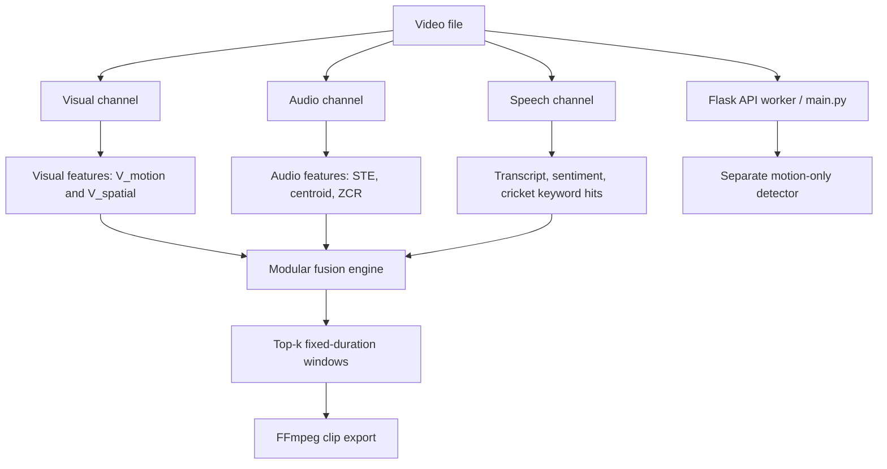

# Multimodal Sports Highlight Extraction

This project experiments with detecting highlight windows by combining visual motion, audio energy, and commentary features.
It evaluates generic cricket and football video inputs, while making clear that the current code does not contain football-specific event detection or human-verified accuracy results.

## Demo / sample output

The official football highlight reel sanity check selected these three six-second windows:

```json
{
  "video": "football_official_highlights.mp4",
  "fusion_windows": [[183, 189], [385, 391], [546, 552]],
  "flagged_percent": 2.514,
  "interpretation": "sanity check on an official highlight reel only; not an accuracy metric"
}
```

The input video is not included in the repository. The machine-readable report is [`results/sanity_football_highlights.json`](results/sanity_football_highlights.json). The same procedure flagged 2.034% of the cricket highlight reel; neither number measures accuracy.

## Key features

- Separate visual, audio, and speech feature pipelines that write timestamped JSON.
- Fusion engine with configurable channel weights and top-k, non-overlapping windows.
- Evaluation against interval labels with IoU matching and single-channel ablations.
- A pseudo-label generator that locates highlight-reel frames in full-match visual embeddings.
- A held-out-match fusion weight experiment for the two cricket matches available in this evaluation.
- Generic visual/audio/speech processing was also run on one football match. No football-specific event classifier, terminology, or human-labeled dataset exists in this repository.

## Architecture



- **Visual:** samples frames, extracts MobileNetV3-Small embeddings, and calculates Farneback optical flow. The fusion engine consumes the `V_motion` score; embeddings are used by the pseudo-label matcher, not normal fusion.
- **Audio:** FFmpeg and librosa produce per-second short-time energy (STE), spectral centroid, and zero-crossing rate. Fusion consumes STE.
- **Speech:** faster-whisper `small` transcribes English commentary. NLTK VADER and a hard-coded cricket keyword list produce sentiment and keyword features; the fusion score uses sentiment and keyword hit. Memory-bounded feature extraction is used for long files.
- **Fusion:** `fusion_channel/fusion_engine.py` min-max normalizes visual motion, STE, and `sentiment_score + 0.5 * keyword_hit`, applies weights `(0.4, 0.4, 0.2)`, and ranks up to three non-overlapping six-second windows by default. This is a fixed-window ranking, not a learned event classifier.
- **Application integration:** the Flask worker calls `main.py`, a separate OpenCV frame-difference detector; it does not call the three channels or modular fusion. `fusion_pipeline.py` is another offline path with different scoring behavior.
- **Football:** the generic channels accept football video, but their speech vocabulary and labels are cricket-oriented and no football-specific logic is implemented. Running them on football is not equivalent to football event detection.

## Results

Metrics below compare predictions with generated visual-similarity pseudo-labels, not independent human annotations. Matching uses IoU >= 0.5 and maximum one-to-one interval matching. Each evaluation ranks at most three six-second windows, while pseudo ground truth contains 61–68 intervals.

| Match | Variant | Precision | Recall | F1 |
|---|---|---:|---:|---:|
| Cricket 1 | Audio only | 0.0000 | 0.0000 | 0.0000 |
| Cricket 1 | Speech only | 0.0000 | 0.0000 | 0.0000 |
| Cricket 1 | Visual only | 0.0000 | 0.0000 | 0.0000 |
| Cricket 1 | Full fusion | 0.0000 | 0.0000 | 0.0000 |
| Cricket 2 | Audio only | 0.0000 | 0.0000 | 0.0000 |
| Cricket 2 | Speech only | 0.6667 | 0.0299 | 0.0571 |
| Cricket 2 | Visual only | 0.0000 | 0.0000 | 0.0000 |
| Cricket 2 | Full fusion | 0.3333 | 0.0149 | 0.0286 |
| Football 1 | Audio only | 0.3333 | 0.0164 | 0.0313 |
| Football 1 | Speech only | 0.3333 | 0.0164 | 0.0313 |
| Football 1 | Visual only | 0.0000 | 0.0000 | 0.0000 |
| Football 1 | Full fusion | 0.3333 | 0.0164 | 0.0313 |

Cricket weight experiment, training on the entirety of Cricket 1 and testing on the separate Cricket 2:

| Method | Weights (visual, audio, speech) | Test precision | Test recall | Test F1 |
|---|---|---:|---:|---:|
| Hand-set | (0.4, 0.4, 0.2) | 0.3333 | 0.0149 | 0.0286 |
| Simplex grid search | (0.0, 0.4, 0.6) | 0.6667 | 0.0299 | 0.0571 |
| Logistic regression | Learned coefficients | 0.0000 | 0.0000 | 0.0000 |

These are one held-out split across two cricket matches, with pseudo-labels; they do not establish generalization. Only one football match was available, so football weights were not trained or tested cross-match. See [evaluation methodology and runtime details](docs/results.md) and JSON under [`results/`](results/).

## Tech stack

Python, OpenCV, PyTorch/TorchVision (MobileNetV3-Small), NumPy, pandas, librosa, FFmpeg, faster-whisper, NLTK/VADER, Flask, SQLAlchemy, React, Vite, and Tailwind CSS.

Pretrained model files are not included. TorchVision and faster-whisper may download weights when first run. `data/`, video files, model weights, environment files, and virtual environments are ignored by Git.

## Installation and quick start

The evaluation ran in an environment where dependencies and model caches already existed; a clean installation was not verified. These are the project setup commands:

```powershell
python -m venv .venv
.\.venv\Scripts\Activate.ps1
python -m pip install -r requirements.txt
```

FFmpeg must be installed and available on `PATH`. To run channels and record per-channel time/RSS for a local video:

```powershell
python benchmark_channels.py --video data\videos\match.mp4 --output-dir data\processed\match --model-size small
```

The benchmark reuses valid existing channel outputs; use `--force` to recompute. To evaluate ablations against interval labels (`[[start, end], ...]`):

```powershell
python evaluate.py --sport cricket `
  --visual data\processed\match\visual_output.json `
  --audio data\processed\match\audio_output.json `
  --speech data\processed\match\speech_output.json `
  --ground-truth results\ground_truth.json `
  --output results\match_evaluation.json
```

Run the synthetic smoke test with `python test_pipeline.py`. It checks pipeline execution/export, not recognition quality.

## Usage examples for both sports

The same generic channels can process a football file, and the evaluation CLI accepts `football` as a report label. This does not add sport-specific event detection:

```powershell
python benchmark_channels.py --video data\videos\football_match.mp4 --output-dir data\processed\football_match --model-size small
python evaluate.py --sport football `
  --visual data\processed\football_match\visual_output.json `
  --audio data\processed\football_match\audio_output.json `
  --speech data\processed\football_match\speech_output.json `
  --ground-truth results\football_ground_truth.json `
  --output results\football_evaluation.json
```

Change the sport label and input paths for cricket. For a pseudo-label from an official reel, first process the full match and reel with `benchmark_channels.py`, then run:

```powershell
python auto_generated_ground_truth.py `
  --full-visual-json data\processed\match\visual_output.json `
  --highlight-visual-json data\processed\official_highlights\visual_output.json `
  --output results\match_ground_truth.json
```

The result is pseudo ground truth and needs manual review before it is treated as annotation.

## Project structure

```text
app/                 Flask API, database models, and job routes
audio_channel/       Audio extraction and acoustic features
docs/                Evaluation methodology, results, and limitations
frontend/            React/Vite dashboard
fusion_channel/      Modular fusion and highlight window export
results/             Machine-readable generated evaluation reports
speech_channel/      Whisper transcription and commentary features
tests/               Regression tests for bounded processing and utilities
visual_channel/      Frame sampling, visual embeddings, and optical flow
main.py              Separate motion-only application worker
fusion_pipeline.py   Alternate offline fusion implementation
evaluate.py          IoU evaluation and modality ablations
training_weights.py  Match-held-out weight experiment
```

## Limitations and future work

- Match labels are pseudo ground truth from visual similarity to official highlight reels, not manually verified event annotations. Unmatched reel segments and merged intervals are not confirmed true/false events.
- Results cover two cricket matches and one football match. Only cricket has a distinct train/test match pair; even that is a single split and not generalization evidence.
- The top-three prediction cap is restrictive relative to the number of pseudo-label intervals.
- There is no football event model or football vocabulary. Speech processing is English-language and the keyword vocabulary is cricket-specific.
- The Flask worker remains motion-only; full multimodal channels and modular fusion are not wired into the application job path. The file picker does not upload browser-selected files.
- Clean dependency installation, frontend build, and API launch with a configured database were not validated.
- The evaluation hardware was Windows 11 with an RTX 2050 (4 GiB VRAM) and 7.73 GiB RAM. Runtime results depend on that hardware and the observed implementation differences.

Next steps: manually annotate a representative set of matches, validate across more held-out matches, create football event features, connect the multimodal pipeline to the application, and add outcome assertions for detection quality.

## Team and acknowledgements

Team member names and roles were not present in the repository and are not invented here; add verified names before external presentation. The project depends on the open-source libraries listed above and TorchVision MobileNetV3-Small pretrained weights. Video sources and contributor acknowledgements should be credited according to their actual licenses and provenance.
